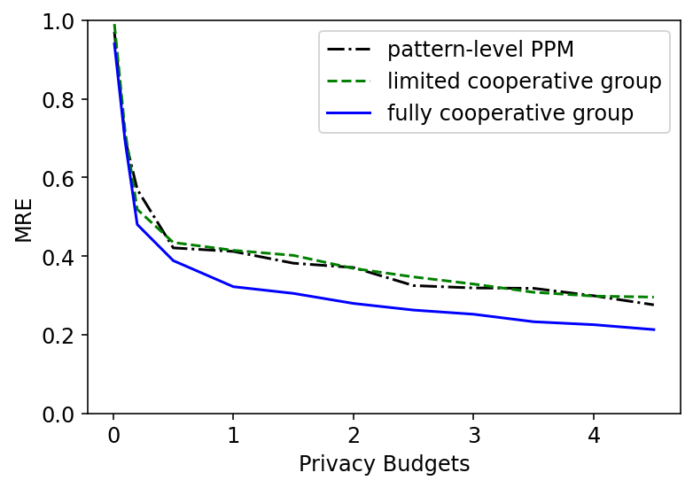
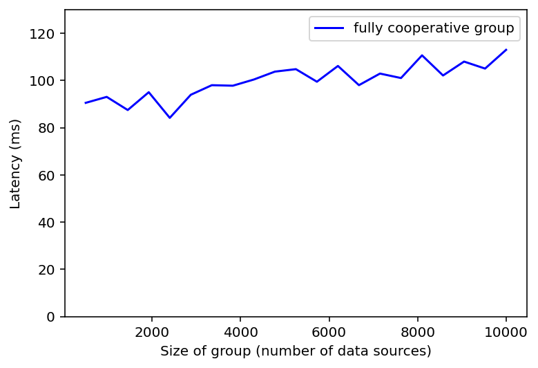

# Group Privacy in Distributed Event Processing
Experiments regarding Preserving Group Privacy in Distributed Event Processing. 

Group Privacy are protected in the form of patterns, i.e., complex events, consisting of events produced by multiple data sources controlled by different data producers. Certain patterns may reveal condifential information shared and recognized by multiple data producers, which are group-level private patterns. Meanwhile, certain patterns may of data consumers' interests, which are group-level target patterns.

The major challenge is to model such scenarios and to preserve group-level private patterns while maintain sufficient utility regarding detecting group-level target patterns.

This Repo. consists of experiments and implementations that address this challenge, regarding preserving group privacy in distributed event processing.

This Repo. includes a complete implementation, though some of them have not been discussed in detail in our paper.

## Environments
This experiments are essentially implemented with Java, Python, and Apache Flink.
1. **Java Development Kit (JDK)**: Version 17
2. **Python**: 3.13.5 
3. **Maven**: Version 3.8 or higher
4. **Apache Flink**: 2.3.0
5. **(Optional) Operating System**: Windows 11

## Datasets
We are not attaching any original datasets directly in this public repo., in order to clarify the credits of their original producers. Please find them in their original websites/research [1-5].

## Execution of experiments
#### 1. Load files into \inputs folder. Each file contains data of a data source.
#### 2. Execute DataStreamJob.
#### 3. Find results in Console or in \outputs folder, including **group-privacy-expr.txt**, **original-target.csv**, **dme-target.csv**, and **consumer-target.csv**.

   The .txt files includes all event processing logs during experiments, while .csv files include the detected target patterns reported from different entities, i.e., data sources, data management engine, and data consumer.
   
   An Example of fully cooperative groups in local privacy model. Note that the Data Management Engine (DME) is only logically integrated but physically distributed in the simulation:
```
  Outliers Removed > column=3, rawMin=0.0, rawMax=121.31662, lower=116.09501, upper=117.05254, scale=0.023938249999999783
  Outliers Removed > column=4, rawMin=0.0, rawMax=58.26441, lower=39.68629, upper=40.20095, scale=0.01286649999999998
  Noise mode: fully cooperative
  Num_Data_Sources: 1000
  DME window> integration mode=LOGICAL, total=4, potential_private=3, non_Private=1, num_events_in_private_patterns=8
  DME noise added> user=0002_2, sequence=57, recordId=2, before=[116.45427, 39.88317], after=[116.45427, 39.84910491685066], noise=[0.0, -0.03406508314933632]
  DME window> integration mode=LOGICAL, total=8, potential_private=1, non_Private=7, num_events_in_private_patterns=8
  ...
  ...
  DME> Received 82429 records，9864 target patterns detected.
  Data consumer has received 811292 GPS records from 999 data sources.
  Average Latency: 117.1514 ms
  Data Consumer> Received 811292 records, from 999 data sources，9864 target patterns detected.
  Original GPS> All users generated 10202 target patterns.
  Expr. End
```
```
  TP: 9,199 | FP: 665 | FN: 1,003
  Recall: 0.9017
  Precision: 0.9326
  F1 score: 0.9169
  MRE: 0.0831
```
#### 4. Plot figures using Python scripts. E.g.,

   
#### 5. (Optional) Python scripts can also provide theoretical insights in a much faster way, which, however, is not implemented via Apache Flink.

## Configuration
### Implement different types of groups and patterns by configuring these variables in Java:
1. **(Detailed in paper)** Fully cooperative groups in local privacy model:
```
  1-1. private static final boolean USER_NOISE = false;
  1-2. private static final DmeMode DME_MODE = DmeMode.LOGICAL;
```
2. **(Detailed in paper)** Limited cooperative groups in local privacy model:  
```   
  2-1. private static final boolean USER_NOISE = true;
```
3. **(Not detailed in paper)** Fully cooperative groups in central privacy model:
```
  3-1. private static final boolean USER_NOISE = false;
  3-2. private static final DmeMode DME_MODE = DmeMode.PHYSICAL;
```
4. **(Not detailed in paper)** Limited cooperative groups in central privacy model: 
```
  4-1. private static final boolean USER_NOISE = true;
  4-2. private static final DmeMode DME_MODE = DmeMode.PHYSICAL;
```

### Other selected important configurations:
```
    private static final int MAX_RECORDS_PER_USER = 100; //number of records to be read in each file, i.e., from each data source
    private static final long USER_TO_USER_DELAY_MS = 15; //the simulated network latency among data sources
    private static final long USER_TO_DME_DELAY_MS = 15; //the simulated network latency between each data source and the data management engine
    private static final long MAX_INPUT_FILES = 1000; //the number of data sources
    private static final int RECORDS_PER_USER = 1; //minimum records from each data producer within a window
    private static final int RECORDS_ALL_USER = 20; //size of a window
    private static final long MAX_WINDOW_WAIT_MS = 100L; //maximum time span of a window in ms
    private static final int NOISE_RECORD_COUNT = 4; //minimum number of events to form a private pattern
    private static final double EPSILON = 1.0; //total privacy budgets
    private static final int PRIVATE_COUNT = SIZE * SIZE / 100; //percentage of private patterns
    private static final int TARGET_COUNT = SIZE * SIZE / 100; //percentage of target patterns
    private static final double OUTLIER_FRACTION = 0.01; //percentage of outliers to be removed, mostly about invalid values in input files
```
## References

[1] Y. Zheng. (2011) T-drive trajectory data sample. [Online]. Available: https://www.microsoft.com/en-us/research/publication/t-drive-trajectory-data-sample/

[2] J. Yuan, Y. Zheng, C. Zhang, W. Xie, X. Xie, G. Sun, and Y. Huang, “T-drive: driving directions based on taxi trajectories,” in Proceedings of the 18th SIGSPATIAL International conference on advances in geographic information systems, 2010, pp. 99–108.

[3] J. Yuan, Y. Zheng, X. Xie, and G. Sun, “Driving with knowledge from the physical world,” in Proceedings of the 17th ACM SIGKDD international conference on Knowledge discovery and data mining, 2011, pp. 316–324.

[4] Tianchixiaomiaomeng. (2018) Ad display/click data on taobao.com. [Online]. Available: https://tianchi.aliyun.com/dataset/56

[5] Tianchi, “Taobao dataset for click-through rate prediction,” 2018. [Online]. Available: https://tianchi.aliyun.com/dataset/dataDetail?dataId=56
